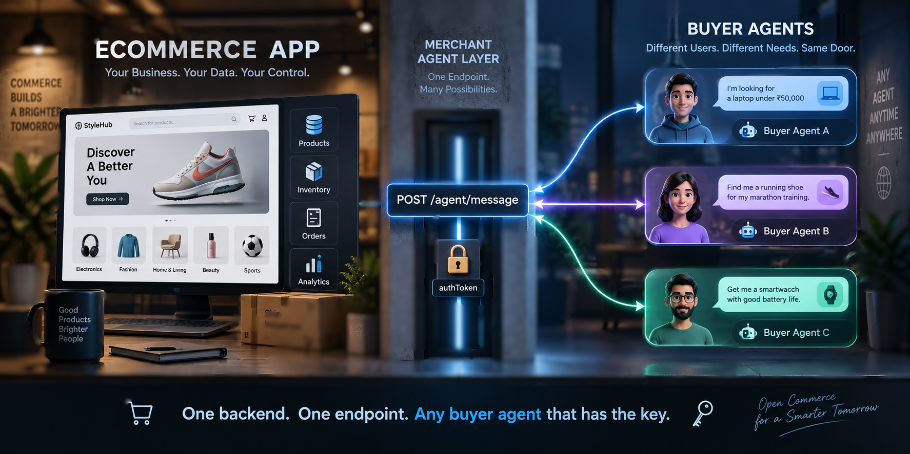
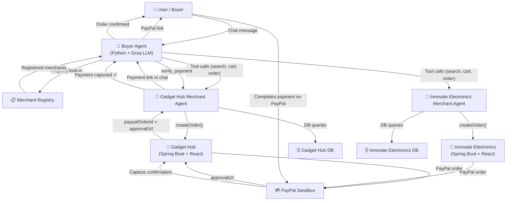
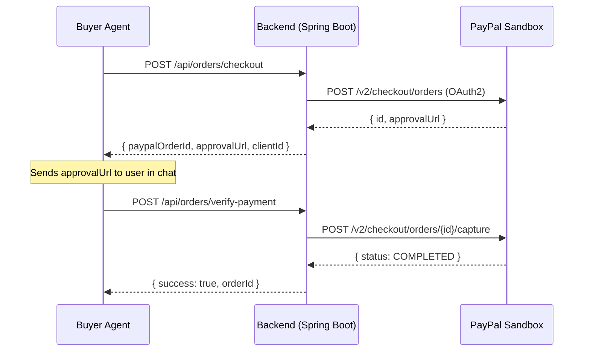
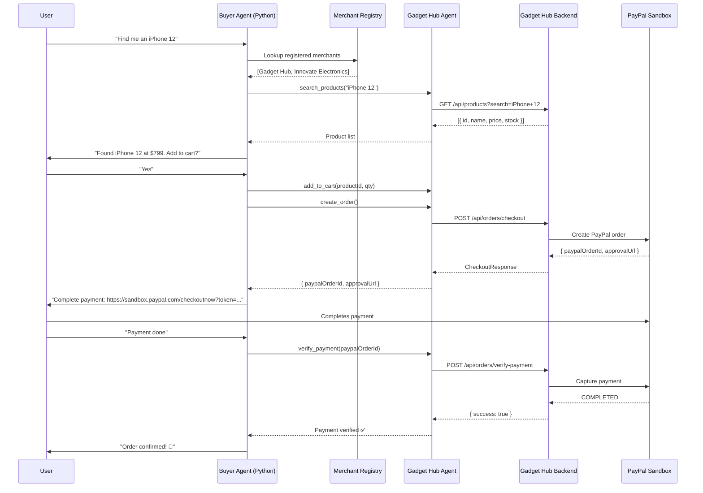

<div align="center">
  
</div>

<h1 align="center">🛒 Agentic Commerce Platform</h1>
<p align="center">
  <b>An AI-powered, agent-to-agent e-commerce ecosystem where buyers and merchants communicate through intelligent agents — from product discovery to PayPal checkout, all in a single chat.</b>
</p>

<p align="center">
  
  
  
  
  
  
</p>

---

## 📌 Abstract

Modern AI assistants (ChatGPT, Gemini, etc.) are great at product discovery — but the moment a user wants to **buy** something, they are kicked out to a separate e-commerce website with its own login, cart, and payment flow. This creates a deeply fragmented experience.

The **Agentic Commerce Platform** solves this by enabling **AI agents to talk directly to merchant AI agents** on behalf of the buyer — searching inventory, negotiating, adding to cart, and completing a **PayPal payment** — all within a single conversational interface. No redirects. No re-logins. No context switching.

---

## ❌ The Problem — Today's Fragmented Shopping Journey

When a user wants to buy something today:

1. 🔍 They search for products through ChatGPT, Gemini, or another AI assistant.
2. 📋 They receive product recommendations pointing to different websites.
3. 🔗 They click an external product link and leave the AI assistant.
4. 🔐 They log in to that particular e-commerce application.
5. 🛒 They add products to the cart and complete payment on that platform.
6. 🔄 They return to the original chatbot if they need further assistance.

Every e-commerce platform maintains its own:

| Concern | Per-Platform Silo |
|---|---|
| Authentication | Separate accounts on every site |
| Product Catalogue | No cross-platform search |
| Shopping Cart | No unified cart |
| Payment Gateway | Different integrations per site |
| Order Management | Fragmented order history |

---

## ✅ The Solution — Agentic Commerce Platform

Three tightly integrated components work together to deliver a **unified, AI-driven shopping experience**.

---

### A. Merchant E-commerce Applications

Two fully independent e-commerce platforms — **Gadget Hub** and **Innovate Electronics** — each built with the same full feature set:

| Feature | Description |
|---|---|
| 🔐 User Authentication | Secure login / registration |
| 📦 Product Management | Full CRUD product catalogue |
| 🛒 Cart Management | Add, update, remove items |
| 📋 Order Management | Order lifecycle tracking |
| 💳 PayPal Payment Integration | PayPal Smart Buttons + order capture |
| 🤖 Merchant Agent Integration | Exposes tools for buyer agents to call |

#### 🪪 Agent Info — The Digital Business Card

Each merchant application exposes an **Agent Info** section. This is a machine-readable profile that buyers can register with their Buyer Agent to establish a trusted connection.

```
Merchant Name:        Gadget Hub
Merchant Email:       gadgethub@example.com
Agent Endpoint:       http://localhost:8081/agent/message
Agent Description:    Gadget Hub merchant agent for electronics
Supported Caps:       search_products, check_inventory, create_order,
                      verify_payment, add_to_cart, get_price
```

Think of this as a **digital business card for AI agents** — once registered, the buyer agent can call the merchant's tools directly.

---

### B. Buyer Agent Application

The central hub of the ecosystem. It has two core modules:

#### 1. Merchant Registry

Users register multiple merchant agents. The registry tracks connection status in real time.

| Merchant | Agent Endpoint | Status |
|---|---|---|
| Gadget Hub | `http://localhost:8081/agent/message` | ✅ Connected |
| Innovate Electronics | `http://localhost:8082/agent/message` | ✅ Connected |

#### 2. AI Chat Interface

A conversational interface powered by **Groq LLM (llama3-8b-8192)** where users can:

- 🔍 Discover and compare products across all registered merchants
- 🛒 Add items to cart through natural language
- 💳 Receive a **PayPal payment link** directly in the chat
- ✅ Verify payment status — all without leaving the chat window

**Example conversation:**
```
Buyer  → "Do you have iPhone 12 in stock and what's the price?"
Agent  → "Yes! Gadget Hub has iPhone 12 for $799. Want me to add it to your cart?"
Buyer  → "Yes, please."
Agent  → "Done. Here's your PayPal checkout link: https://sandbox.paypal.com/checkoutnow?token=..."
Buyer  → "I've completed the payment."
Agent  → "✅ Payment verified. Your order #ORD-2024-001 is confirmed!"
```

---

### C. Merchant Admin Dashboard

Each merchant has a dedicated admin panel to monitor and manage agent-driven activity:

| Feature | Description |
|---|---|
| 🤖 Agent Interactions | Full log of buyer agent requests |
| 📊 Agent-Generated Orders | Orders placed by buyer agents on behalf of users |
| 👤 Customer Info | User profiles and purchase history |
| 📅 Activity History | Timeline of all agent events |
| 💰 Transaction Info | PayPal order IDs and payment statuses |

---

## 🏗️ System Architecture



---

## ⚡ What Makes It Different

| Differentiator | Description |
|---|---|
| 🤖 **Merchant Agent Registry** | Buyers register merchants once; the agent handles all future interactions automatically |
| 📡 **Agent-to-Agent Communication** | Buyer agent calls merchant agent tools over HTTP — no human clicks required |
| 🔍 **Unified AI Shopping** | Search, compare, and buy from multiple merchants in a single conversation |
| 💬 **Chat-Based Checkout** | Add to cart and receive a PayPal link — entirely within the chat window |
| ✅ **Payment Verification** | Agent confirms PayPal capture status and updates order — no manual refresh needed |

---

## 🛠️ Technical Stack

| Layer | Technology |
|---|---|
| **Backend** | Java 17, Spring Boot 3.x, Maven |
| **Frontend** | React 18, Vite, Axios |
| **Merchant Agent Core** | Python 3.11, FastAPI, httpx |
| **LLM** | Groq Cloud — `llama3-8b-8192` |
| **Payment** | PayPal REST API (Sandbox) |
| **Database** | MySQL (per merchant) |
| **Auth** | JWT (Spring Security) |

---

## 📁 Project Structure

```
Ecommerce-App/
├── ecommerce-backend/                  # Spring Boot backend (per merchant)
│   ├── src/main/java/com/ecommerce/
│   │   ├── auth/                       # JWT authentication
│   │   ├── order/
│   │   │   ├── OrderService.java       # Checkout + PayPal integration
│   │   │   ├── PaypalService.java      # PayPal REST API client
│   │   │   ├── Order.java              # JPA entity (paypal_order_id, paypal_payment_id)
│   │   │   ├── CheckoutResponse.java   # Returns paypalOrderId + approvalUrl
│   │   │   └── VerifyPaymentRequest.java
│   │   ├── product/                    # Product catalogue
│   │   ├── cart/                       # Cart management
│   │   └── tools/
│   │       ├── payment/
│   │       │   ├── CreateOrderTool.java    # Exposes createOrder to buyer agent
│   │       │   └── VerifyPaymentTool.java  # Exposes verifyPayment to buyer agent
│   │       └── model/ToolRequest.java
│   └── pom.xml
│
├── ecommerce-frontend/                 # React frontend (per merchant)
│   ├── src/
│   │   ├── pages/
│   │   │   ├── Cart.jsx                # PayPal Smart Buttons in cart
│   │   │   └── Checkout.jsx            # PayPal redirect handler + capture
│   │   ├── utils/
│   │   │   └── paypal.js               # loadPayPalScript + renderPayPalButtons
│   │   └── services/orderService.js
│   └── index.html                      # PayPal SDK loaded dynamically via paypal.js
│
├── merchant-agent-core/                # Python merchant agent server
│   ├── app/
│   │   ├── agent/
│   │   │   ├── merchant_agent.py
│   │   │   └── agent_loop.py
│   │   ├── planning/planner.py         # Groq LLM decision loop
│   │   ├── llm/llm_client.py           # Groq API client (JSON-in-text, no native tools)
│   │   └── tools/
│   │       └── payment/
│   │           └── payment_tool_adapter.py       # Sends paypalOrderId to backend
│   └── .env                            # LLM_MODEL=llama3-8b-8192
│
├── buyer-agent/                        # Buyer-side agent + registry UI
│   └── ...
│
├── create_payment_page.py              # PayPal payment page generator
├── payment_page.html                   # PayPal Smart Buttons payment page
└── README.md
```

---

## 💳 PayPal Integration

### Overview

This project uses the **PayPal REST API (Sandbox)** for all payment processing. No real money is involved during development.

### Environment Setup

Add the following to your backend `application.properties` (or `.env`):

```properties
paypal.client-id=YOUR_PAYPAL_CLIENT_ID
paypal.client-secret=YOUR_PAYPAL_CLIENT_SECRET
paypal.base-url=https://api-m.sandbox.paypal.com
paypal.currency=USD
```

### PayPal Order Flow



### Key Classes

| Class | Responsibility |
|---|---|
| `PaypalService.java` | OAuth2 token management, `createOrder()`, `capturePayment()` |
| `OrderService.java` | Orchestrates checkout and payment verification |
| `CheckoutResponse.java` | Returns `paypalOrderId`, `approvalUrl`, `clientId`, `totalAmount` |
| `VerifyPaymentRequest.java` | Accepts `paypalOrderId` and `paypalPaymentId` |
| `src/utils/paypal.js` | Frontend: loads PayPal SDK, renders Smart Buttons |
| `src/pages/Cart.jsx` | Renders PayPal Smart Buttons in cart summary |
| `src/pages/Checkout.jsx` | Handles `?token=` redirect from PayPal, triggers capture |

### Testing PayPal Sandbox

1. Log in at [developer.paypal.com](https://developer.paypal.com) → Sandbox → Accounts
2. Use the sandbox **buyer** account credentials when prompted on the PayPal checkout page
3. After approval, the backend captures the payment automatically
4. Order status updates to `PAID` in the merchant database

---

## 🔄 Full Agent Message Flow



---

## 🚀 Getting Started

### Prerequisites

- Java 17+
- Maven 3.8+
- Node.js 18+
- Python 3.11+
- MySQL 8+
- PayPal Developer Account (Sandbox)
- Groq API Key

### 1. Backend Setup (per merchant)

```bash
cd ecommerce-backend

# Configure application.properties
paypal.client-id=YOUR_CLIENT_ID
paypal.client-secret=YOUR_CLIENT_SECRET
paypal.base-url=https://api-m.sandbox.paypal.com
paypal.currency=USD

# Build and run
./mvnw spring-boot:run
```

### 2. Frontend Setup (per merchant)

```bash
cd ecommerce-frontend
npm install
npm run dev
```

### 3. Merchant Agent Core Setup

```bash
cd merchant-agent-core
pip install -r requirements.txt

# Configure .env
LLM_MODEL=llama3-8b-8192
GROQ_API_KEY=YOUR_GROQ_API_KEY
JAVA_TOOL_LAYER_URL=http://localhost:8081

python main.py
```

### 4. Buyer Agent Setup

```bash
cd buyer-agent
pip install -r requirements.txt
python main.py
```

---

## 🌐 Repositories

| Repository | Description |
|---|---|
| [Buyer_agent](https://github.com/Sachin-MR05/Buyer_agent) | Buyer Agent Application (Python + Groq) |
| [Agentic_Commerce](https://github.com/Sachin-MR05/Agentic_Commerce) | Merchant Agent Core |
| [Ecommerce-App](https://github.com/Sachin-MR05/Ecommerce-App) | Merchant E-commerce Backend + Frontend |

---

## 📚 References

- [PayPal REST API Documentation](https://developer.paypal.com/api/rest/)
- [PayPal Sandbox Testing Guide](https://developer.paypal.com/tools/sandbox/)
- [Groq Cloud API](https://console.groq.com/)
- [Spring Boot Documentation](https://spring.io/projects/spring-boot)
- [React Documentation](https://react.dev/)
- [FastAPI Documentation](https://fastapi.tiangolo.com/)

---

## 👨‍💻 About Me

<div align="center">

**Sachin M R**

[](https://github.com/Sachin-MR05)
[](https://www.linkedin.com/in/sachin-m-r)

*Building the future of agentic commerce — where AI agents shop for you.*

</div>
